# GUÍA DEMO · Documentación de lo realizado
**Centro Médico Horizonte, S.A. · PF-TEL-001-2026**
Última actualización: 23/10/2026

Registro visual de todo lo configurado en el proyecto, para el equipo y para la defensa. Cada captura indica su ruta dentro del sistema y explica qué se hizo y por qué. El avance se agrega por componente.

| Componente | Estado | Sección |
|---|---|---|
| PBX FreePBX en máquina virtual | Configurada y probada con llamadas reales, extras E1, E3 y E4 completos | 2 a 7 |
| Router MikroTik RB750Gr3 (hEX) | VLAN, DHCP, NAT, firewall y QoS cargados (20/10). Faltan las pruebas y las mediciones | 8 |
| Punto de acceso Mercusys MW325R | En modo AP con `CMH-Voz` en la VLAN 20 (20/10). Falta la captura del Wi-Fi | 9 |
| Sesión de pruebas con el equipo | Pruebas 1 a 17 y 19 completas el 23/10. La 18 y la 20 con evidencia del 19 y 20/10 | 12 |

> Las capturas están en la carpeta `capturas/` y no muestran contraseñas. Para verlas dentro de este documento se recomienda un visor de Markdown, por ejemplo GitHub o VS Code (**Ctrl+Shift+V**). Las extensiones de cada integrante y las pruebas por persona están en `GUIA-CELULARES.md`.

---

## 1. La solución en breve

| Elemento | Valor |
|---|---|
| Plataforma | FreePBX 17.0.33 y Asterisk 22.11 sobre Debian 12.15, en VirtualBox |
| Nombre del sistema | `CMH-PBX Centro Medico Horizonte` |
| Extensiones | 9, de 4 dígitos, numeradas por área (1xxx Recepción, 2xxx Consulta Externa, 3xxx Enfermería y Emergencias, 4xxx Administración, 5xxx TI) |
| Números especiales | 7000 IVR, 8000 grupo de Recepción, 8010 cola de Consulta Externa |
| IP de la PBX con el router | 172.16.20.10 (VLAN 20, Voz) |
| IP de la PBX por Tailscale | 100.91.176.16, fija desde cualquier red |
| Idioma | Español latino (`es_419`), con respaldo en español estándar |

---

## 2. Plataforma de la PBX (criterio C)

**Figura 1. Panel principal.** Ruta: *Dashboard*

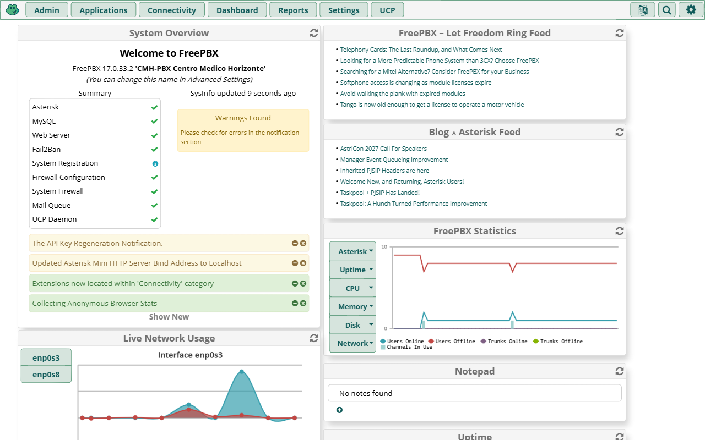

> **Qué se hizo.** Es la pantalla de inicio después de entrar. Arriba se ve el nombre asignado al sistema (*CMH-PBX Centro Medico Horizonte*) y la versión, FreePBX 17.0.33.2. En la lista de servicios, Asterisk, la base de datos, el servidor web, fail2ban y el firewall están en verde, es decir, la PBX está en funcionamiento. Abajo se ve el tráfico de las dos tarjetas de red de la VM (`enp0s3` para teléfonos y `enp0s8` para administración).

**Figura 2. Extensiones.** Ruta: *Connectivity → Extensions*

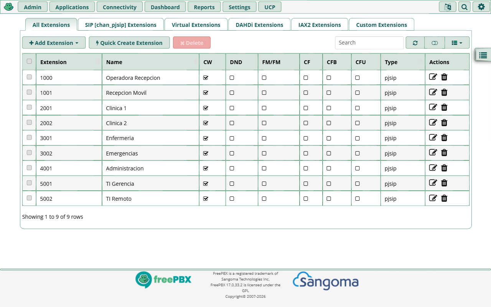

> **Qué se hizo.** Se crearon las 9 extensiones del plan de numeración, una por puesto de trabajo. El primer dígito indica el área. Todas son de tipo **pjsip**, el protocolo SIP actual de Asterisk, y tienen la llamada en espera activa (columna CW). Cada una tiene una contraseña aleatoria de 32 caracteres, distinta de las demás.

**Figura 3. Opciones avanzadas de una extensión.** Ruta: *Connectivity → Extensions → 1000 → Advanced*

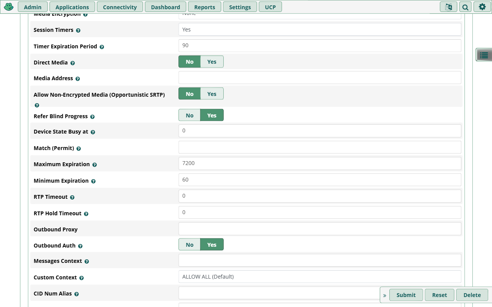

> **Qué se hizo.** Se configuró **Direct Media en No** en las 9 extensiones. Así el audio de las llamadas siempre pasa por la PBX en lugar de ir directo entre teléfonos. Esto permite que el audio cruce el router y reciba la prioridad de QoS, y que las llamadas funcionen aunque haya NAT de por medio.

**Figura 4. Ajustes SIP.** Ruta: *Settings → Asterisk SIP Settings*

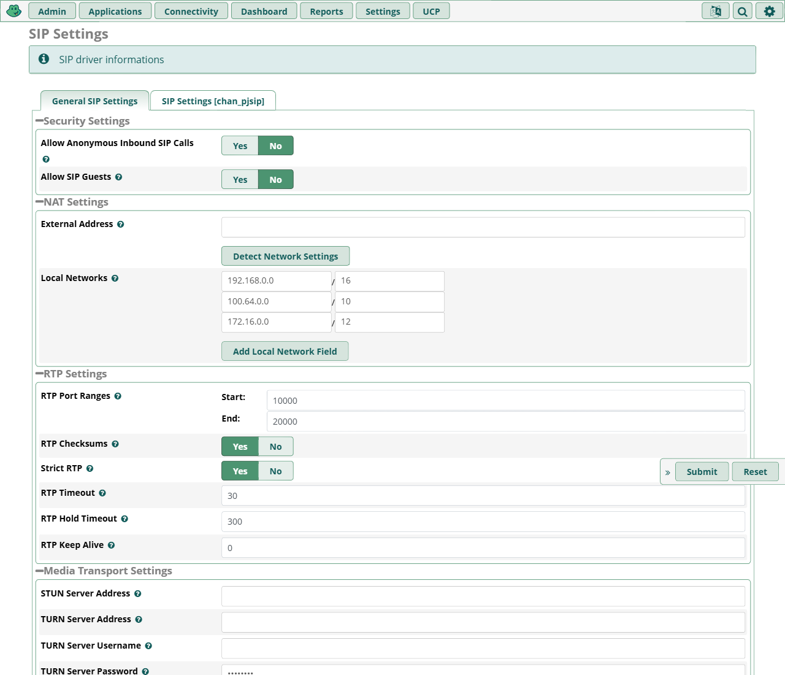

> **Qué se hizo.** Se dejaron en **No** las llamadas anónimas y los invitados, para que nadie use la PBX sin usuario y contraseña. En *Local Networks* se declararon las redes del proyecto (172.16.0.0/12 para las VLAN en clase B y 100.64.0.0/10 para Tailscale), así Asterisk identifica qué teléfonos están en la red interna. Abajo está el rango de puertos del audio (RTP 10000 a 20000), el mismo que usan las reglas del router. Los códecs habilitados son ulaw, alaw, g722 y opus.

---

## 3. Funcionalidades de telefonía (criterio D)

**Figura 5. Códigos de transferencia y llamada en espera.** Ruta: *Admin → Feature Codes*

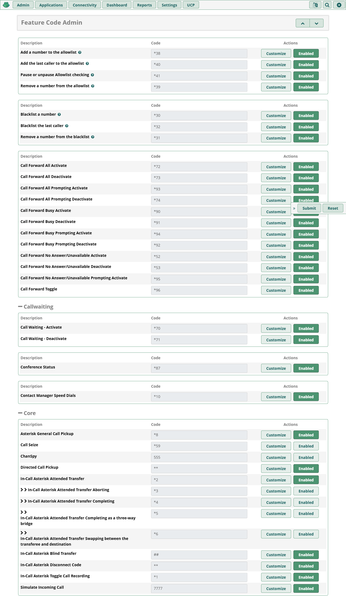

> **Qué se hizo.** Se verificó que estén activos los códigos de servicio, que son números que empiezan con `*` o `#` y activan funciones desde el teléfono. Llamada en espera **\*70** (activar) y **\*71** (desactivar). En la sección *Core*, **##** para la transferencia ciega y **\*2** para la atendida. Empiezan con símbolos para no chocar con las extensiones de 4 dígitos.

**Figura 6. Prueba de eco y acceso al IVR.** Ruta: *Admin → Feature Codes*

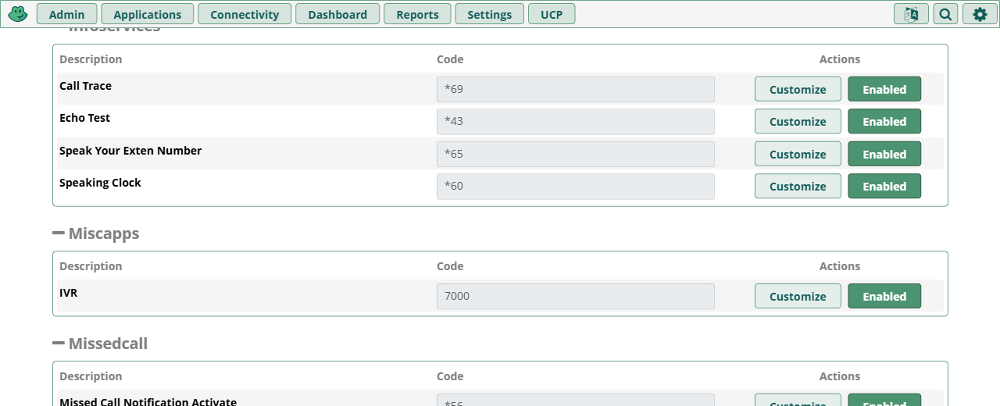

> **Qué se hizo.** **\*43** es la prueba de eco, donde quien llama escucha su propia voz y se comprueba el audio. **7000** es el número interno para entrar al IVR.

**Figura 7. Códigos de horario y buzón.** Ruta: *Admin → Feature Codes*

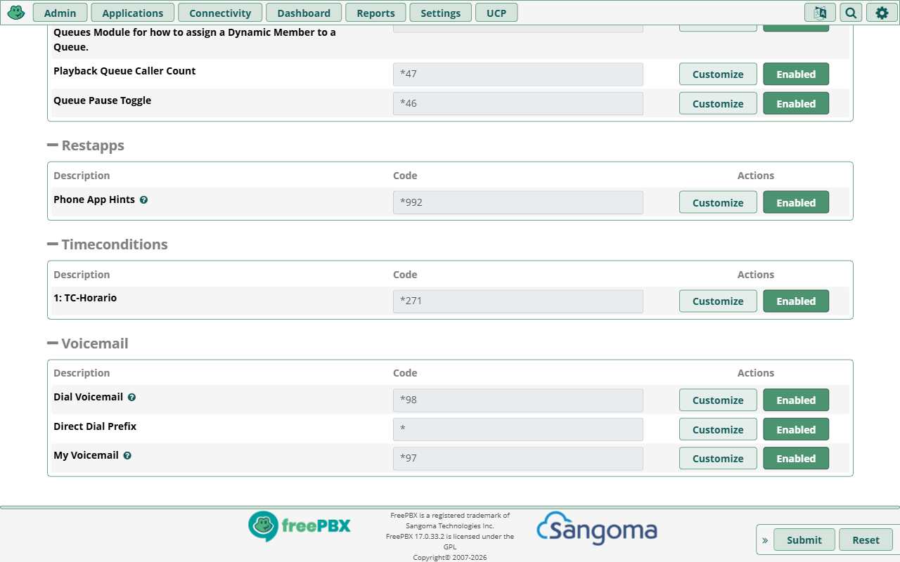

> **Qué se hizo.** **\*271** cambia a mano el modo de horario (normal o fuera de horario) y se usa en la demostración. **\*97** entra al buzón de la propia extensión y **\*98** a cualquier buzón, con su número y su PIN.

**Figura 8. Grabaciones del sistema.** Ruta: *Admin → System Recordings*

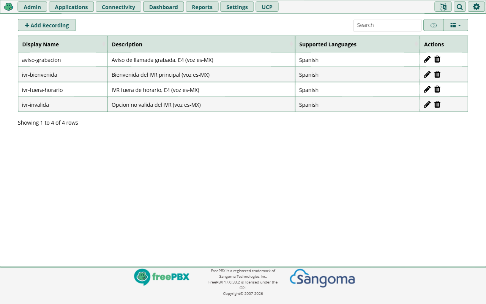

> **Qué se hizo.** Se cargaron 4 locuciones en español: bienvenida del IVR, opción no válida, mensaje de fuera de horario y aviso de grabación de la llamada. Se generaron con la voz de Windows *Sabina* (español de México), en formato telefónico de 8 kHz. Pueden reemplazarse por voz humana grabando desde un teléfono con los mismos nombres.

**Figura 9. Menú de voz principal.** Ruta: *Applications → IVR → IVR-Principal*

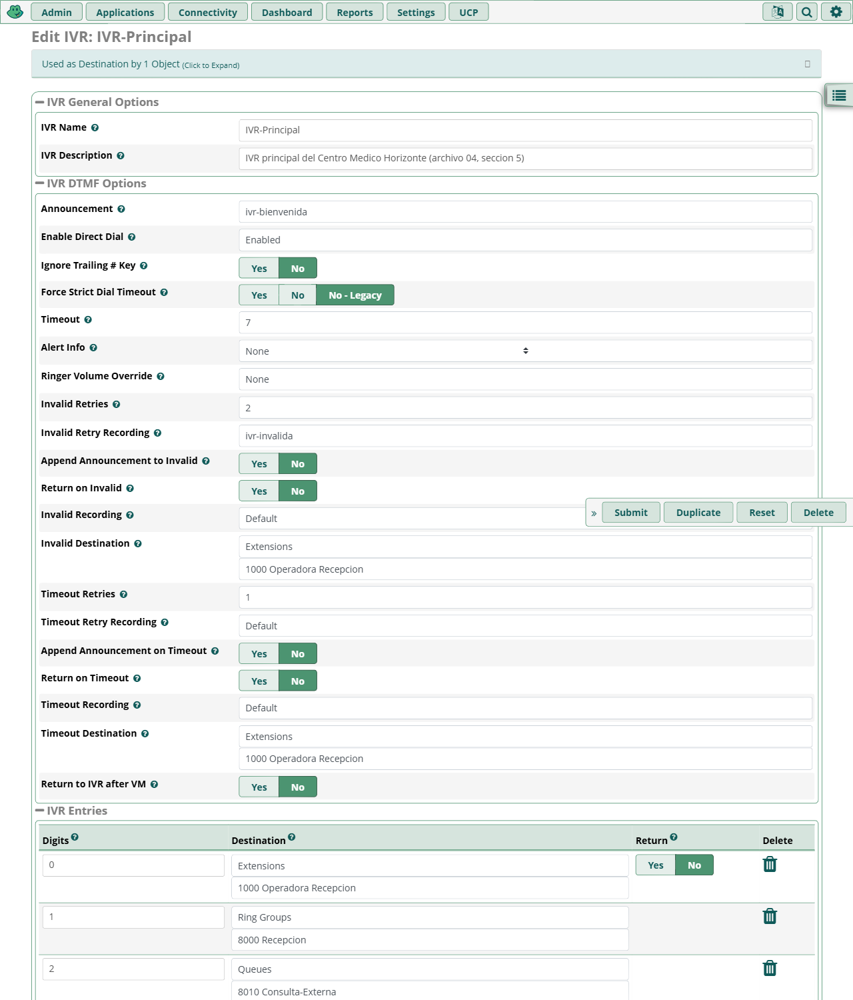

> **Qué se hizo.** Se creó el IVR con la bienvenida como anuncio, **7 segundos** para marcar y hasta **2 intentos** ante una opción no válida. Si la persona se equivoca tres veces, o se queda sin marcar dos veces seguidas, la llamada pasa a la **operadora (1000)**. Opciones: 1 Recepción (grupo 8000), 2 Consulta Externa (cola 8010), 3 Enfermería (3001), 4 Administración (4001) y 0 operadora. Cumple §5.4 del PDF: tres o más opciones, operadora, opción inválida y falta de respuesta.

**Figura 10. Número interno del IVR.** Ruta: *Applications → Misc Applications*

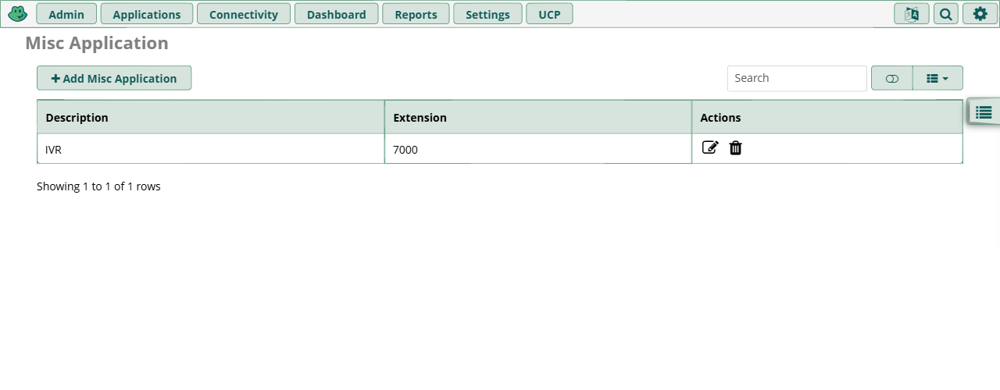

> **Qué se hizo.** Se creó el número **7000** para llegar al IVR desde cualquier extensión. Apunta a la condición de horario (figura 15), que decide qué IVR contesta según la hora.

**Figura 11. Idiomas del sistema.** Ruta: *Admin → Sound Languages*

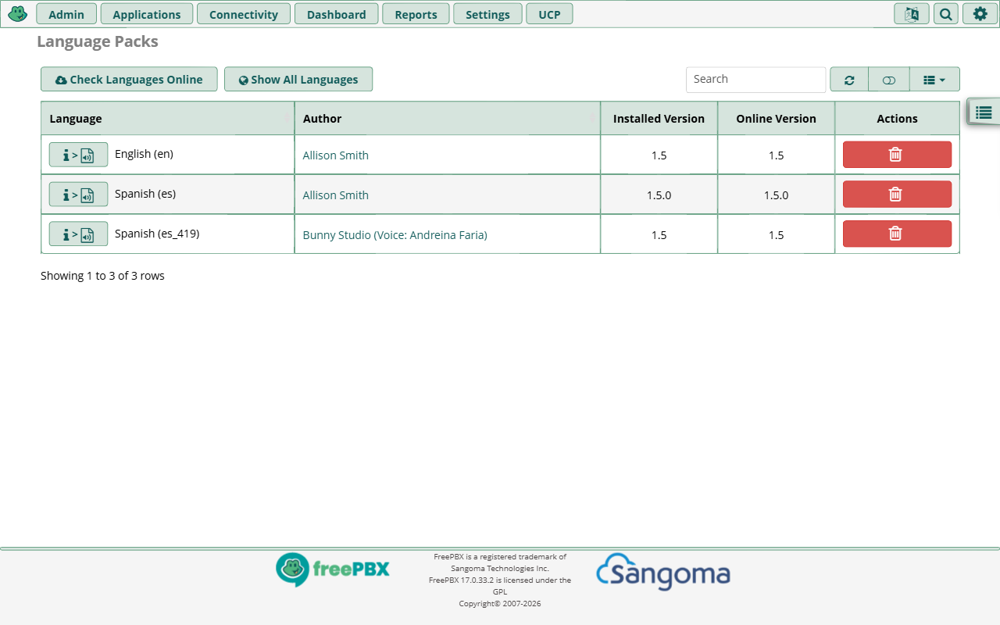

> **Qué se hizo.** Se instalaron los sonidos del sistema en español, que son los mensajes que la PBX dice por su cuenta (por ejemplo "deje su mensaje después del tono" y los números). Quedó **español latino (es_419)** como idioma principal y el español estándar (es) como respaldo, porque al paquete latino le faltan algunos audios.

**Buzones de voz (sin captura).** Las extensiones 1000, 2001, 3001 y 4001 tienen buzón con PIN propio y **saludo personalizado** de no disponible, de ocupado y de nombre, en la misma voz del IVR. Si nadie contesta en 20 segundos, o la extensión está ocupada, la llamada pasa al buzón. Los mensajes se escuchan con \*97.

---

## 4. Funciones avanzadas, extra E4

**Figura 12. Grupo de timbrado de Recepción.** Ruta: *Applications → Ring Groups → 8000*

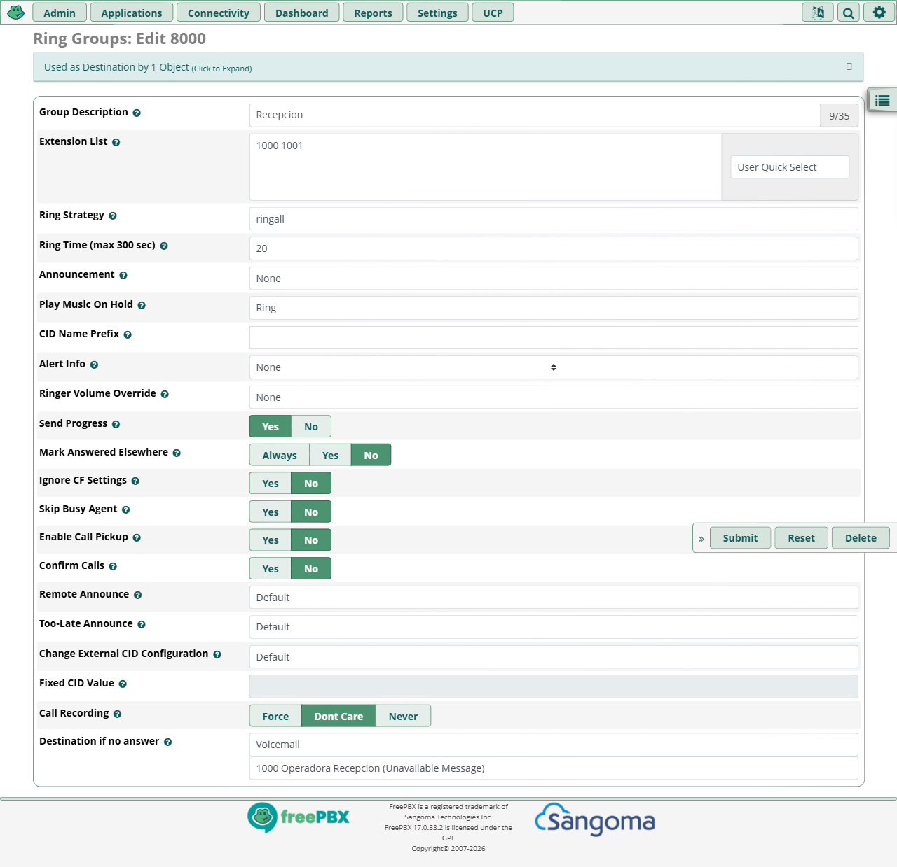

> **Qué se hizo.** Se creó el grupo **8000 (Recepción)** con las extensiones **1000 y 1001**. La estrategia *ringall* hace que suenen las dos a la vez y la primera que contesta toma la llamada. Si nadie contesta en **20 segundos**, la llamada va al buzón de la 1000. Es la opción 1 del IVR.

**Figura 13. Cola de Consulta Externa.** Ruta: *Applications → Queues → 8010*

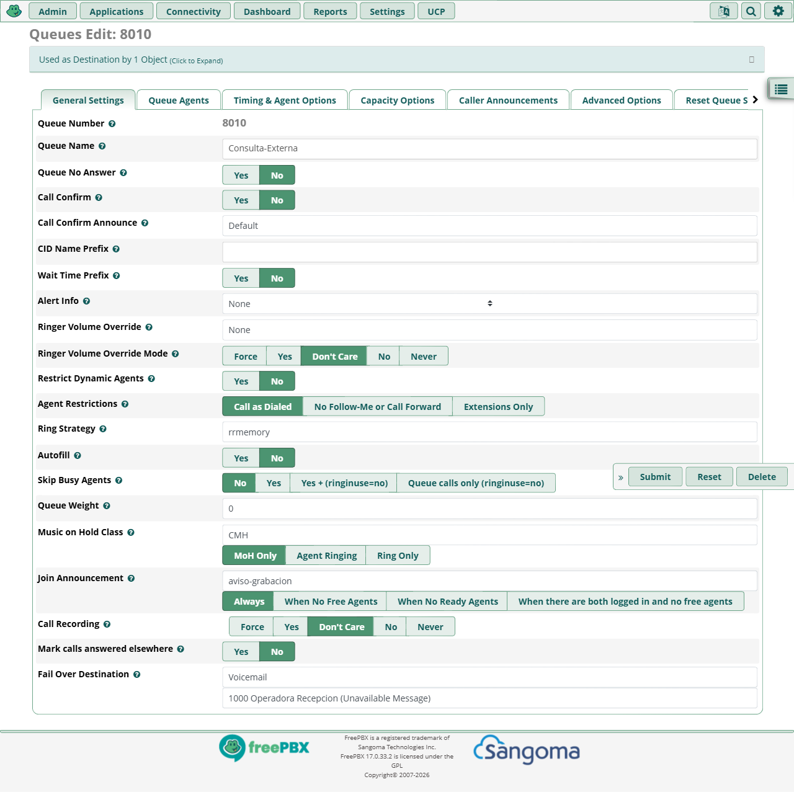

> **Qué se hizo.** Se creó la cola **8010 (Consulta Externa)** con las extensiones 2001 y 2002 como agentes. La estrategia **rrmemory** reparte las llamadas por turnos y recuerda a quién le tocó la última, así la carga queda pareja entre las dos clínicas. Al entrar se escucha el aviso de grabación, se anuncia la posición en la fila cada 30 segundos y suena la música propia (**CMH**). Después de 2 minutos sin respuesta, la llamada pasa al buzón. Es la opción 2 del IVR.

**Figura 14. Horario de atención.** Ruta: *Applications → Time Groups → Horario-Atencion*

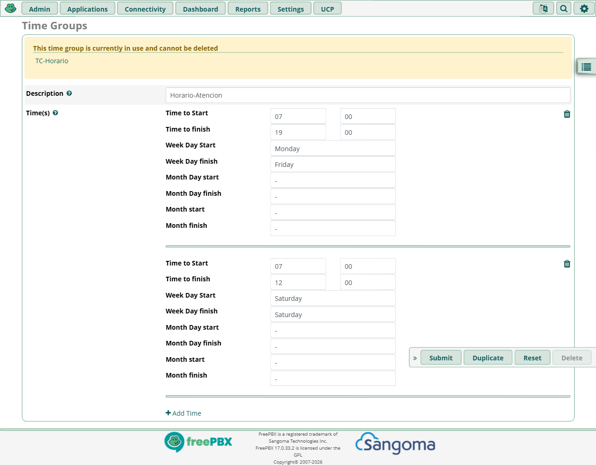

> **Qué se hizo.** Se definió el horario de atención del centro médico, **lunes a viernes de 7:00 a 19:00** y **sábado de 7:00 a 12:00**.

**Figura 15. Condición de horario.** Ruta: *Applications → Time Conditions → TC-Horario*

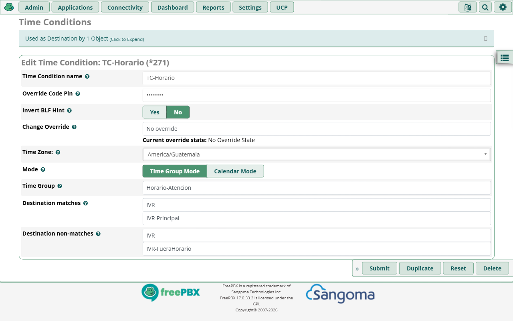

> **Qué se hizo.** Se creó la condición **TC-Horario**, con zona horaria de Guatemala. Dentro del horario de la figura 14 contesta el **IVR-Principal**. Fuera de ese horario contesta el **IVR-FueraHorario**, que solo ofrece Emergencias (3, Enfermería) o dejar un mensaje (1). El código **\*271** cambia el modo a mano para la demostración.

**Figura 16. Música en espera propia.** Ruta: *Settings → Music on Hold → CMH*

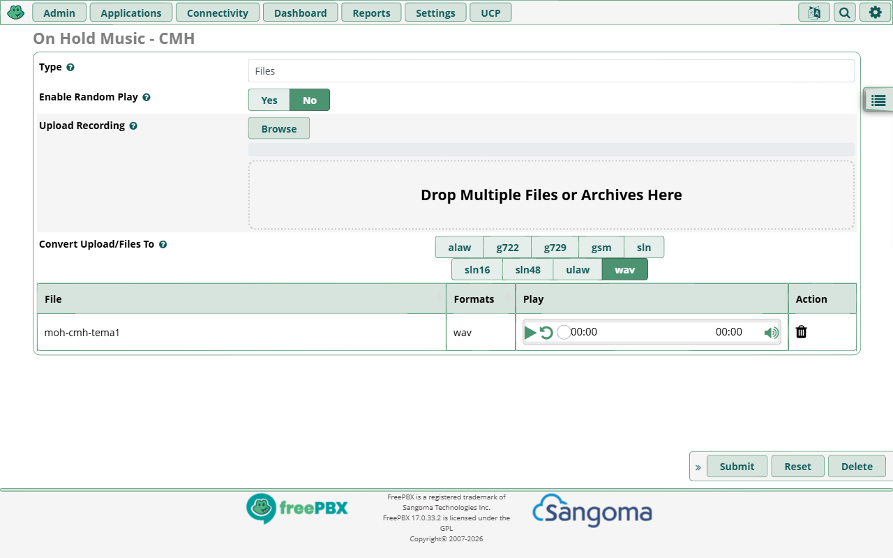

> **Qué se hizo.** Se creó la categoría **CMH** con la pista `moh-cmh-tema1`, compuesta con código para el proyecto. Es original, así que no tiene problemas de derechos de autor. Suena en la cola 8010.

**Figura 17. Grabación de llamadas.** Ruta: *Connectivity → Extensions → 1000 → Advanced → Recording Options*

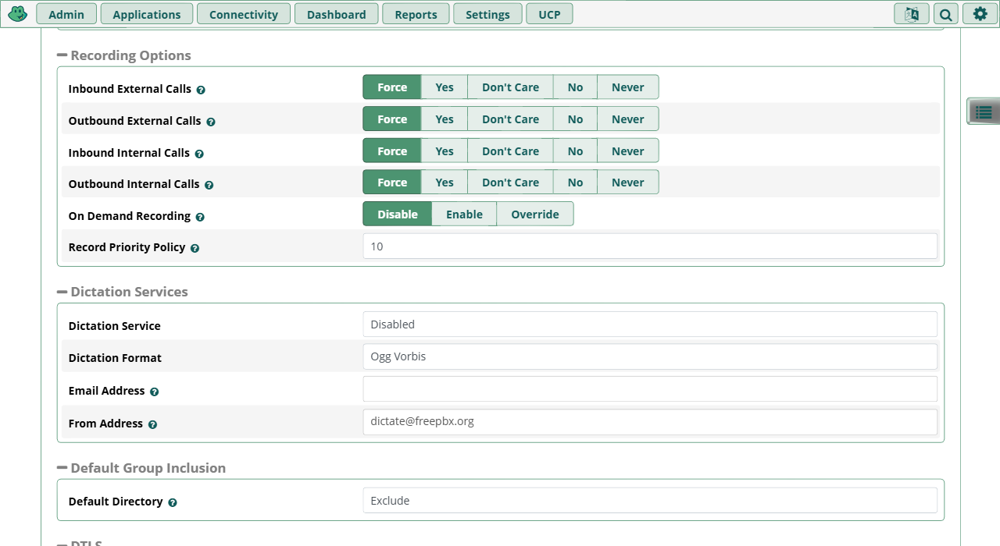

> **Qué se hizo.** En la extensión 1000 (Recepción) se configuró la grabación en **Force** para todas las llamadas, entrantes y salientes, internas y externas. Las grabaciones solo se escuchan desde la administración web, que está restringida a la red de Gestión. Así se cumple el acceso restringido que pide E4.

**Figura 18. Registro de llamadas.** Ruta: *Reports → CDR Reports*

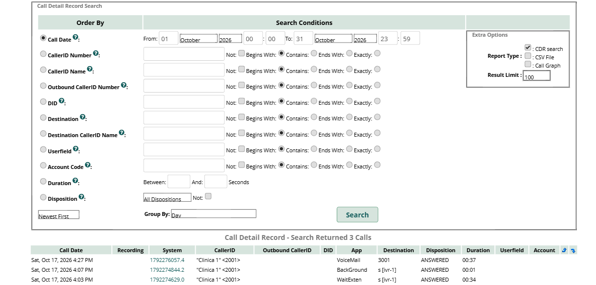

> **Qué se hizo.** El CDR registra cada llamada con fecha, hora, origen (*CallerID*), destino (*App* y *Destination*), si se contestó (*ANSWERED*) y su duración. Aquí se ven las primeras llamadas de prueba del 17/10 desde un celular (extensión 2001) al IVR. Es la evidencia de llamadas para el informe y la matriz de pruebas. Las llamadas de la 1000 incluyen el botón para escuchar la grabación.

**Buzón por correo (quinta función de E4).** Rutas: *Settings → Voicemail Admin → Settings → Email Config* y *Connectivity → Extensions → (1000, 2001, 3001, 4001) → Voicemail*

> **Qué se hizo.** La PBX envía correo por **Gmail** (`smtp.gmail.com`, puerto 587, cifrado TLS) con una **contraseña de aplicación** de la cuenta del proyecto. La contraseña normal de la cuenta no se usa y la de aplicación no aparece en ningún documento. Los 4 buzones mandan cada mensaje a `cmh.horizonte.org@gmail.com` **con el audio adjunto**, con remitente *Centro Medico Horizonte - Buzon de voz* y el asunto y el texto en español. Probado el 20/10: un mensaje dejado en la 1000 llegó al correo con su `.wav`. *Capturas pendientes: configuración del correo y el correo recibido.*

---

## 5. Seguridad de la PBX (§5.8)

**Figura 19. Redes de confianza del firewall.** Ruta: *Connectivity → Firewall → Networks*

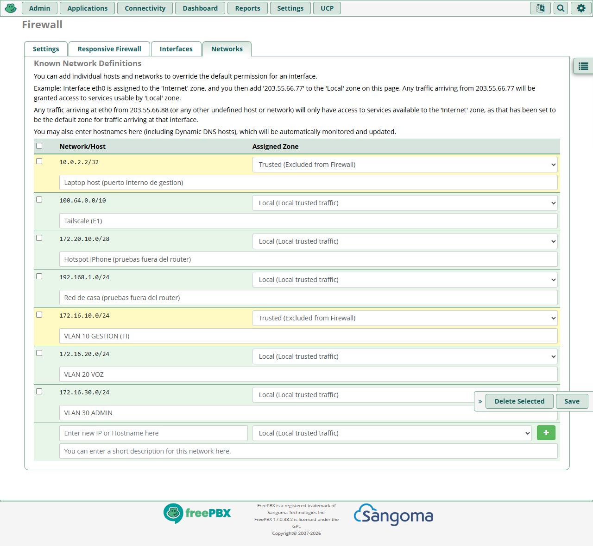

> **Qué se hizo.** Se activó el firewall de FreePBX y se definieron las redes de confianza. En **Trusted** (acceso total) quedaron la laptop que administra la VM (10.0.2.2) y la VLAN 10 de Gestión. En **Local** (solo teléfonos) quedaron la VLAN 20 de Voz, la VLAN 30 Administrativa, Tailscale y las redes de prueba. Cualquier otra red cae en la zona *Internet*, sin acceso.

**Figura 20. Servicios permitidos por zona.** Ruta: *Connectivity → Firewall → Services*

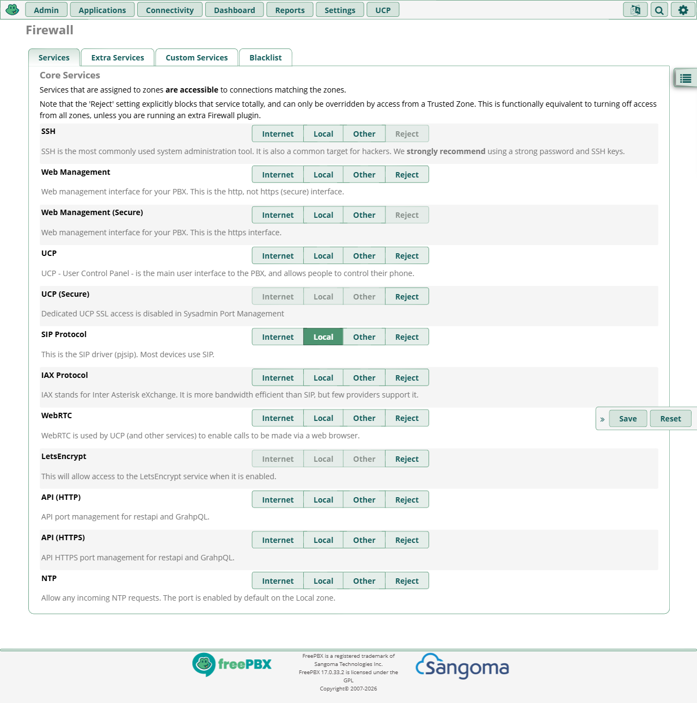

> **Qué se hizo.** **SSH** y la **web de administración** no tienen ninguna zona marcada, así que solo se usan desde las redes *Trusted*. **SIP** está marcado solo en **Local**, para que los teléfonos puedan registrarse. Los demás servicios quedaron cerrados porque no se usan.

**Figura 21. Responsive Firewall.** Ruta: *Connectivity → Firewall → Responsive Firewall*

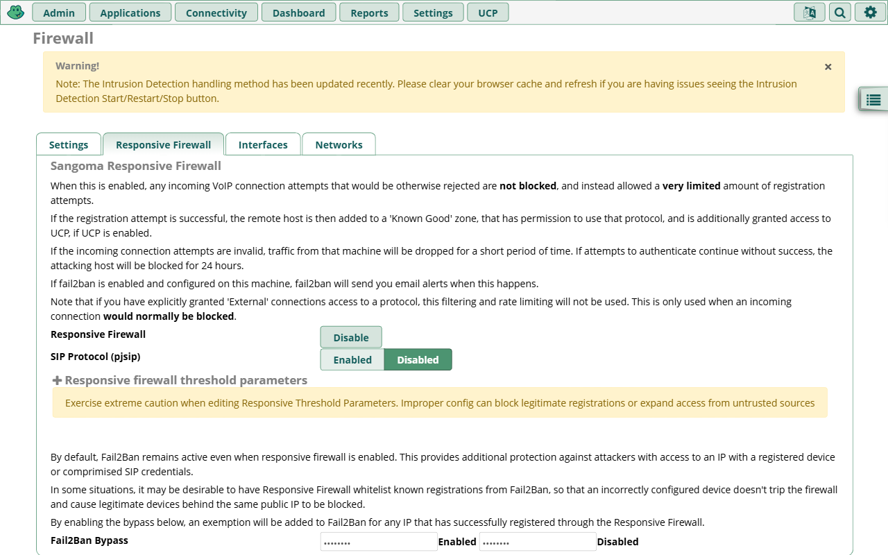

> **Qué se hizo.** El *Responsive Firewall* está activo, con **SIP (pjsip) en Disabled**. El SIP que llega desde redes no confiables se rechaza siempre, sin darle intentos. Es la opción más estricta y no afecta a los teléfonos, porque todos entran por redes *Local*. Contra intentos repetidos de contraseña actúa **fail2ban**, que bloquea 30 minutos al equipo que falla 5 veces en 10 minutos.

**Figura 22. Contraseñas débiles.** Ruta: *Reports → Weak Password Detection*

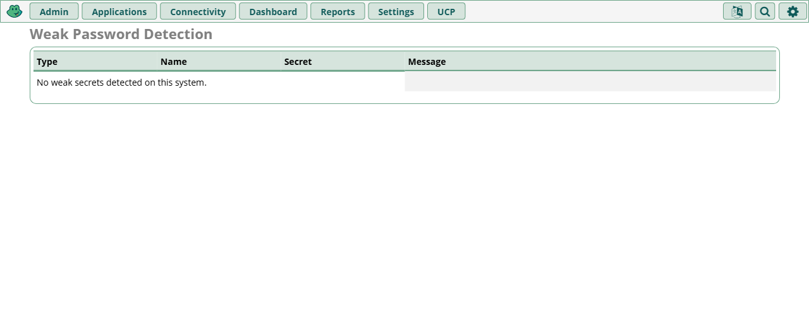

> **Qué se hizo.** El revisor de FreePBX indica *No weak secrets detected*. Ninguna extensión tiene una contraseña débil. Además, el administrador web no se llama `admin` y las contraseñas de Linux que traía la VM base se cambiaron.

**Figura 23. Respaldos automáticos.** Ruta: *Admin → Backup & Restore*

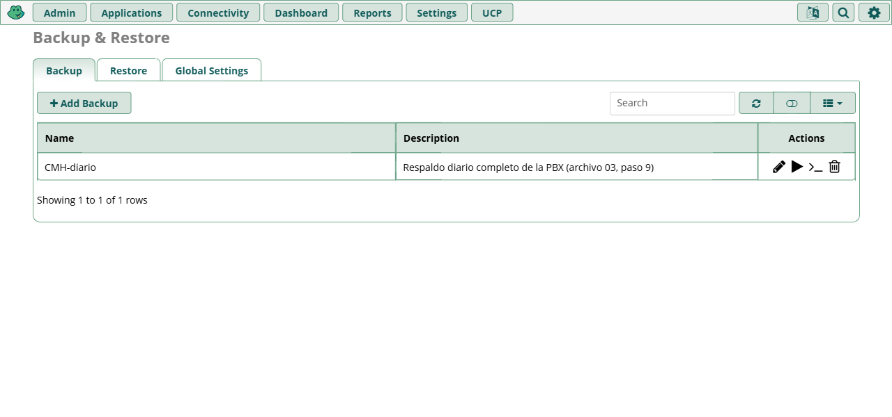

> **Qué se hizo.** Se creó la tarea **CMH-diario**, que guarda toda la configuración de FreePBX cada día a las 2:00 y conserva los últimos 7. Además se exportó la VM completa en un archivo `.ova` como respaldo para la demostración.

---

## 6. Teléfonos registrados (criterio E)

**Figura 24. Estado de las extensiones.** Ruta: *Reports → Asterisk Info → PJSIP*

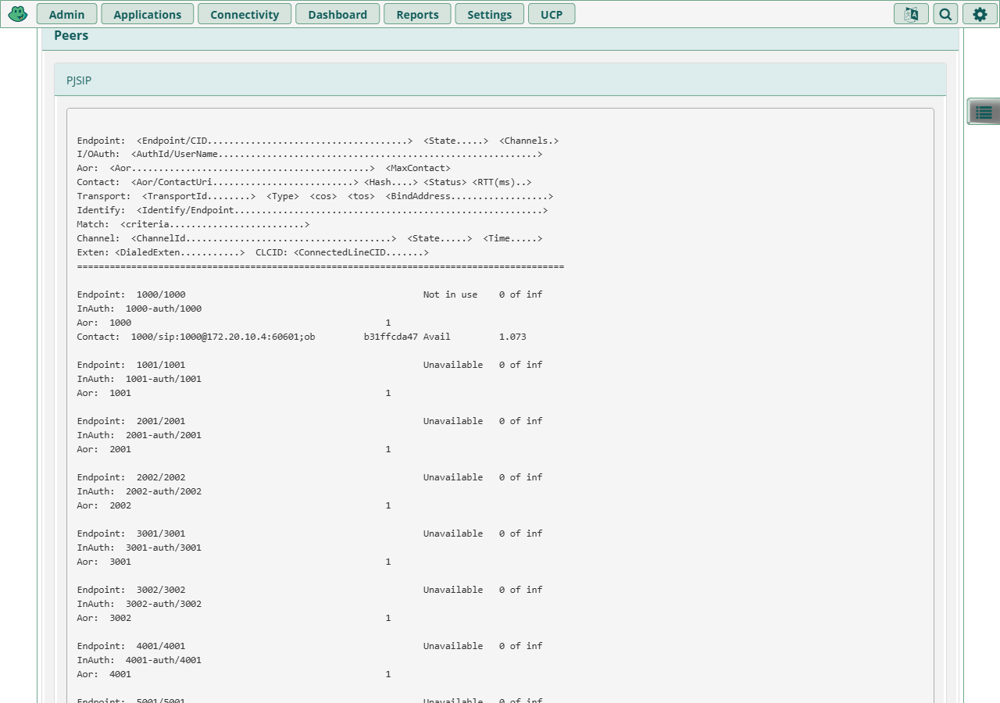

> **Qué se hizo.** Es el estado de los teléfonos visto desde Asterisk. Cada *Endpoint* es una extensión. Un teléfono conectado aparece con una línea *Contact*, su IP y el estado **Avail**, como la 1000 de esta captura (MicroSIP en la laptop). Las que dicen *Unavailable* no tienen un teléfono registrado en ese momento. En la demostración se muestran al menos 4 en *Avail*, con una laptop y un celular.

Los teléfonos usados son **MicroSIP** en laptop y **Linphone** en celulares. La asignación por integrante está en `GUIA-CELULARES.md`.

---

## 7. Acceso desde una red pública, extra E1

**Cómo funciona.** El PDF pide que un teléfono **fuera de la red del centro médico** pueda llamar a la PBX (§6.1). Se usó **Tailscale**, una VPN que crea un túnel cifrado (WireGuard) entre el celular y la PBX. No requiere abrir puertos en el router y funciona aunque el proveedor de internet use CGNAT.

| Equipo | IP en Tailscale |
|---|---|
| PBX (`cmh-pbx`) | 100.91.176.16 |
| iPhone de prueba (extensión 5002) | 100.68.20.81 |

**Figura 25. Interfaz de Tailscale en el firewall.** Ruta: *Connectivity → Firewall → Interfaces*

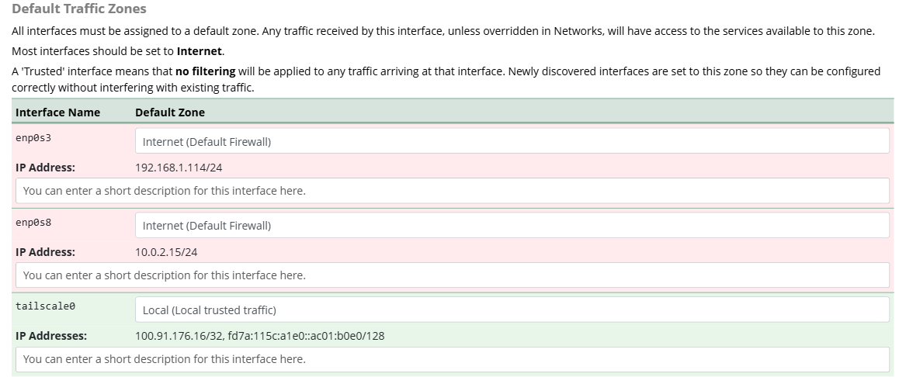

> **Qué se hizo.** Al activar Tailscale apareció en la VM la tarjeta `tailscale0`, con la IP 100.91.176.16. Se le asignó la zona **Local**. Los teléfonos que llegan por el túnel pueden usar **SIP**, pero no la web de administración ni el SSH.

**Figura 26. Redes con Tailscale y pruebas.** Ruta: *Connectivity → Firewall → Networks*

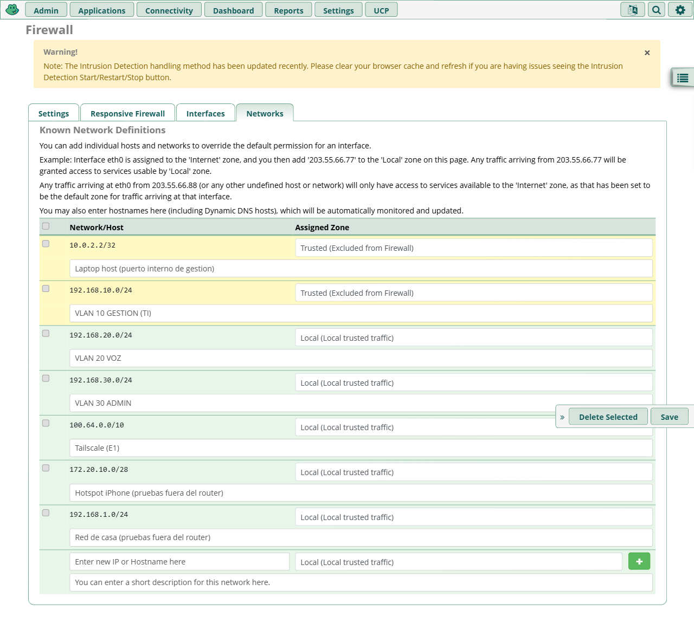

> **Qué se hizo.** La red de Tailscale (**100.64.0.0/10**) está en zona Local. Se agregó también la red **192.168.1.0/24** para pruebas fuera del router. Con el router instalado, los teléfonos entran por las VLAN 20 y 30, que ya están en la lista.

**Figura 27. Llamada de prueba desde datos móviles.** Ruta: *Reports → CDR Reports*

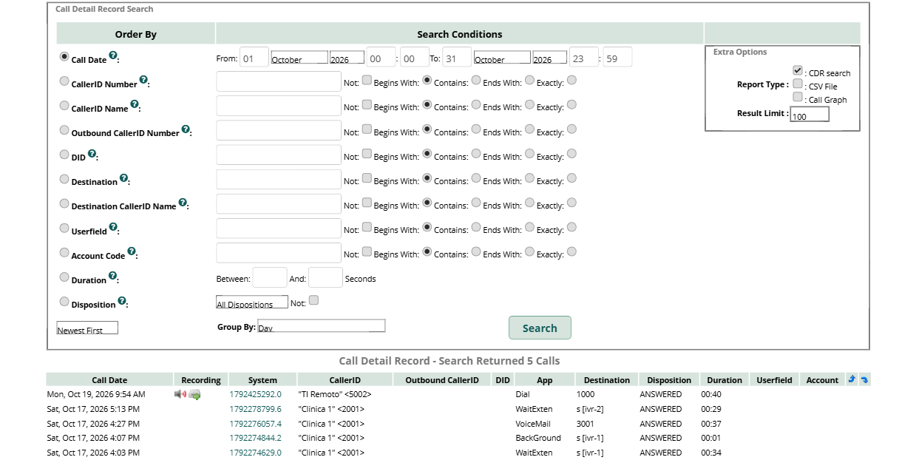

> **Qué se hizo.** La primera fila es la prueba de E1 del 19/10 a las 9:54. El iPhone, **solo con datos móviles** y con Tailscale activo, se registró como la extensión **5002 (TI Remoto)** y llamó a la **1000** (MicroSIP en la laptop). La llamada se contestó y duró 40 segundos con audio en los dos sentidos. El retardo medido fue de 157 a 201 ms, propio de la red celular más el túnel.

### Extra E3, troncal SIP con sip2sip

**Cómo funciona.** El PDF pide conectar la PBX con un proveedor SIP para llamadas hacia y desde afuera (§6.3). Se usó **sip2sip.info**, un servicio SIP gratuito, con dos cuentas. La cuenta `cmh-horizonte` es la **línea del centro médico** y la registra la PBX. La cuenta `cmh-orizonte-ext` hace de **teléfono externo** (un paciente) en un celular.

| Elemento | Configuración |
|---|---|
| Troncal | *Connectivity → Trunks → sip2sip* (PJSIP). Servidor `sip2sip.info:5060`, proxy de salida `proxy.sipthor.net` (el que publica el registro DNS SRV de sip2sip), registro saliente, códecs ulaw, alaw, g722 y opus. Estado: **Registered** |
| Ruta entrante | *Connectivity → Inbound Routes → Entrante sip2sip (E3)*. Toda llamada de la troncal va a la condición de horario **TC-Horario**, igual que la 7000 |
| Llamada saliente | Número corto **9100** hacia `cmh-orizonte-ext`, definido en *Admin → Config Edit → extensions_custom.conf* |

> **Por qué el 9100 no es una ruta saliente.** Las rutas salientes de FreePBX solo aceptan dígitos en sus patrones, y las direcciones de sip2sip son alfanuméricas. FreePBX deformaba el nombre de la cuenta, así que el 9100 se escribió como plan de marcado propio que usa la misma troncal. Con un proveedor de pago que entregue números telefónicos sería una ruta saliente normal con prefijo 9.

> **Prueba del 20/10.** *Entrante (15:18):* el celular con `cmh-orizonte-ext`, por datos móviles, llamó a `cmh-horizonte`. Entró por la troncal, pasó por el horario, contestó el **IVR-Principal** y la llamada se transfirió a la **1000**. *Saliente (15:18):* la 1000 marcó **9100** y sonó el celular externo.

**Figura 27a. Troncal sip2sip.** Ruta: *Connectivity → Trunks*

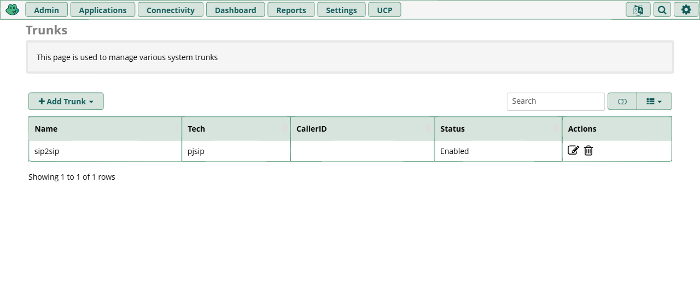

> **Qué se ve.** La troncal **sip2sip**, de tipo PJSIP, está habilitada (*Enabled*). Es la conexión de la PBX con el proveedor SIP externo.

**Figura 27b. Registro de la troncal.** Ruta: *Reports → Asterisk Info → Registries*

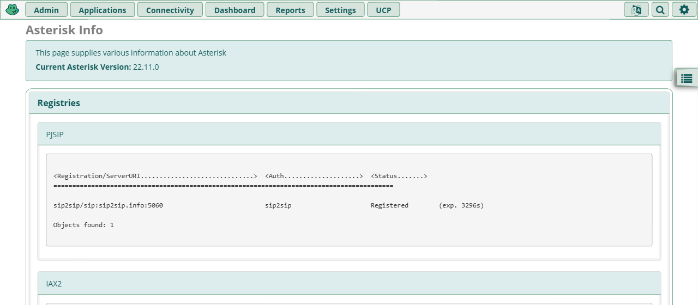

> **Qué se ve.** La PBX está **Registered** en `sip2sip.info:5060` con la cuenta `sip2sip`. Eso significa que el proveedor sabe dónde está la PBX y le puede entregar llamadas. El registro se renueva solo antes de vencer.

**Figura 27c. Ruta entrante.** Ruta: *Connectivity → Inbound Routes*

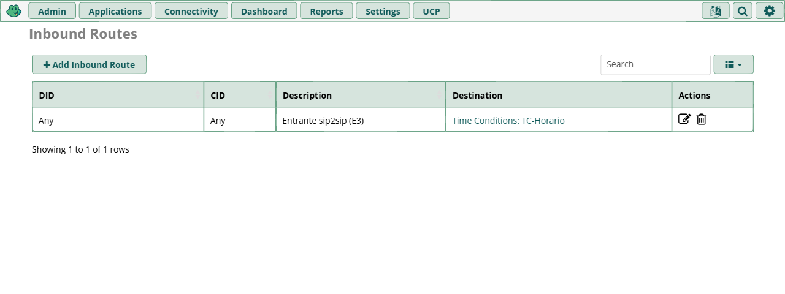

> **Qué se ve.** La ruta **Entrante sip2sip (E3)** acepta cualquier número (*Any*) y manda la llamada a la condición horaria **TC-Horario**. Así, quien llama desde afuera escucha el mismo IVR que la 7000, con el horario de atención aplicado.

**Figura 27d. Llamadas por la troncal.** Ruta: *Reports → CDR Reports* (20/10, de 15:00 a 15:40)

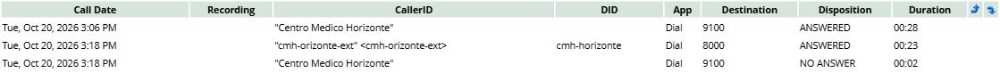

> **Qué se ve.** A las 15:06 la 1000 marcó **9100** y el celular externo contestó (28 segundos, *ANSWERED*). A las 15:18 entró una llamada desde `cmh-orizonte-ext` hacia la línea `cmh-horizonte`. Pasó por el IVR, se eligió la opción 1 y la contestó el grupo de Recepción (**8000**). La última fila es un segundo intento de salida que no se contestó.

**Limitaciones para el informe.** No se puede llamar a teléfonos de la red pública (PSTN) sin un proveedor de pago, la calidad depende de internet y del servicio gratuito, y la PBX queda detrás de NAT (doble NAT con el router). sip2sip resuelve el NAT del lado del proveedor.

---

## 8. Router MikroTik RB750Gr3 (hEX)

Configurado el 20/10 con RouterOS 7.24.5 y los tres scripts de `plan/02_RED_MIKROTIK_HEX_Y_AP.md` (base, firewall y QoS). Las capturas son de Winbox, conectado desde la VLAN 10 de Gestión. Faltan las mediciones de QoS con y sin prioridad.

**Figura 28. Sistema, firmware y usuarios.** Ruta: *New Terminal*

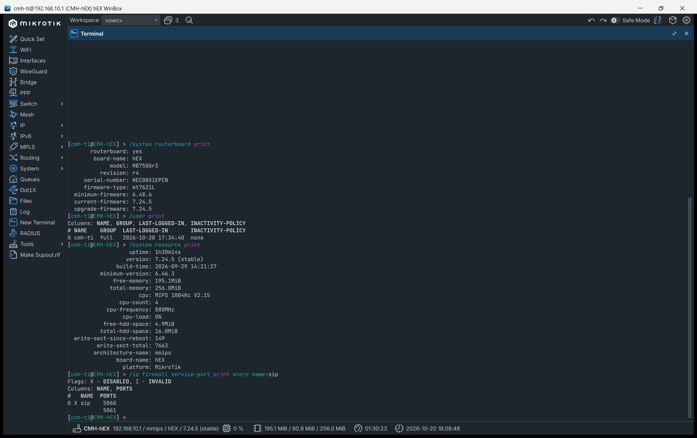

> **Qué se hizo.** El router se reseteó sin la configuración del dueño anterior y se actualizó a **RouterOS 7.24.5**, con el firmware de la placa en la misma versión. El único usuario es `cmh-ti` en el grupo *full*. Al final se ve que el **SIP ALG** está desactivado (bandera X).

**Figura 29. Usuario `admin` eliminado.** Ruta: *New Terminal*

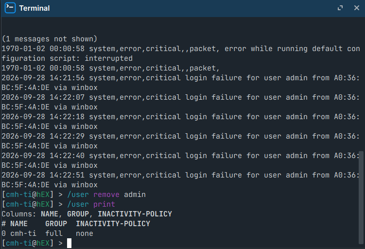

> **Qué se hizo.** Se eliminó el usuario `admin` que trae el equipo de fábrica. Los intentos de entrar con ese usuario quedan registrados como *login failure* en el log del router.

**Figura 30. Interfaces.** Ruta: *Interfaces → Interface*

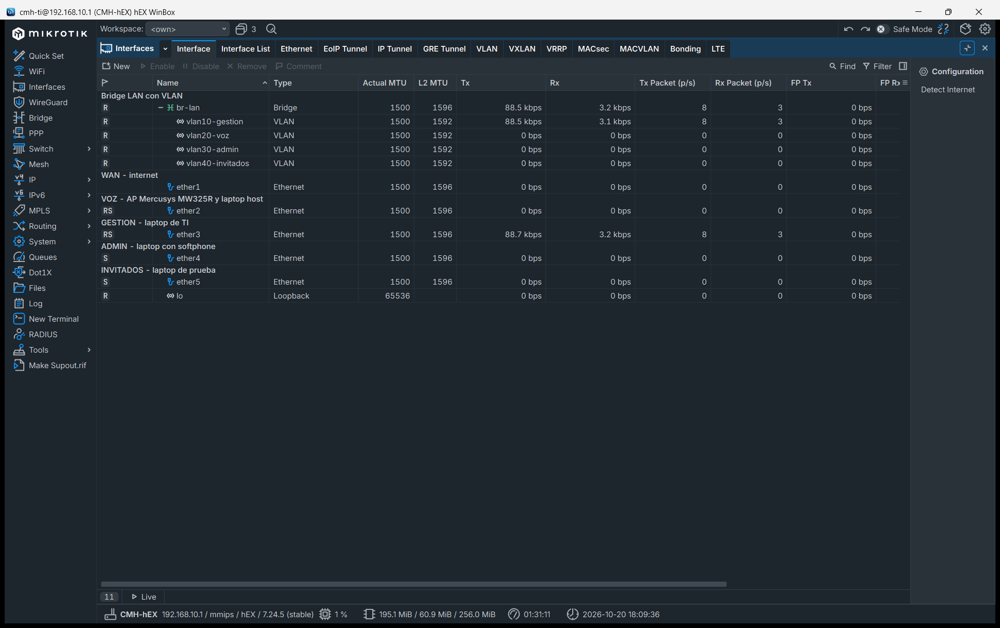

> **Qué se hizo.** Los puertos ether2 a ether5 están dentro del bridge `br-lan`. Sobre el bridge están las cuatro interfaces VLAN, una por red. Cada puerto lleva un comentario con su uso, y ether1 queda fuera del bridge como salida a internet.

**Figura 31. Puertos del bridge.** Ruta: *Bridge → Ports*

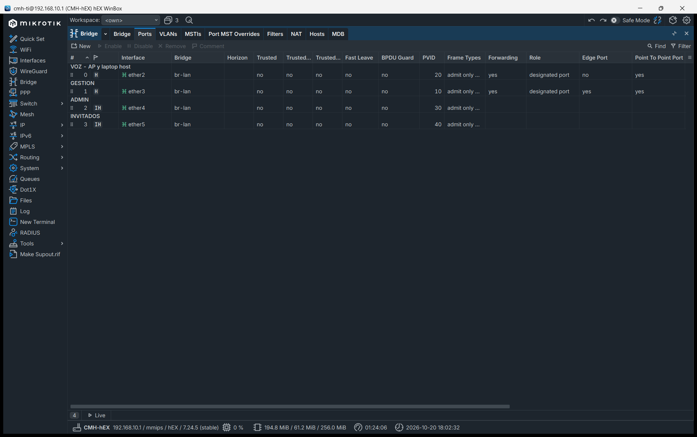

> **Qué se hizo.** Cada puerto es de acceso a una sola VLAN (PVID 20, 10, 30 y 40) y solo acepta tráfico sin etiqueta. La bandera **H** indica que el chip del hEX hace la conmutación por hardware.

**Figura 32. Tabla de VLAN.** Ruta: *Bridge → VLANs*

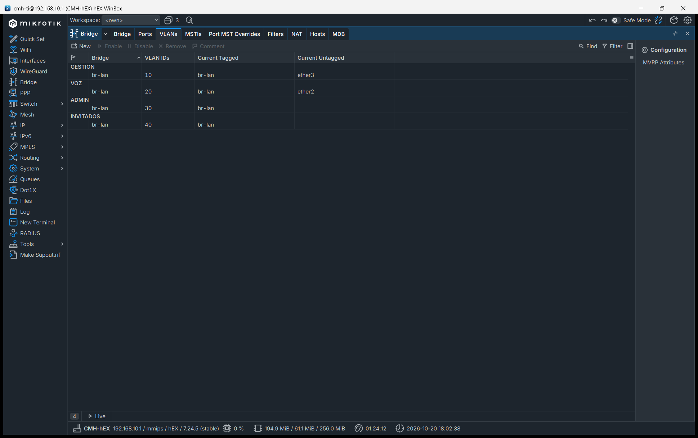

> **Qué se hizo.** Las cuatro VLAN están etiquetadas hacia el propio router (`br-lan`), que hace de puerta de enlace, y sin etiqueta hacia su puerto. La columna *Current Untagged* solo muestra los puertos con cable conectado.

**Figura 33. Direcciones IP.** Ruta: *IP → Addresses*

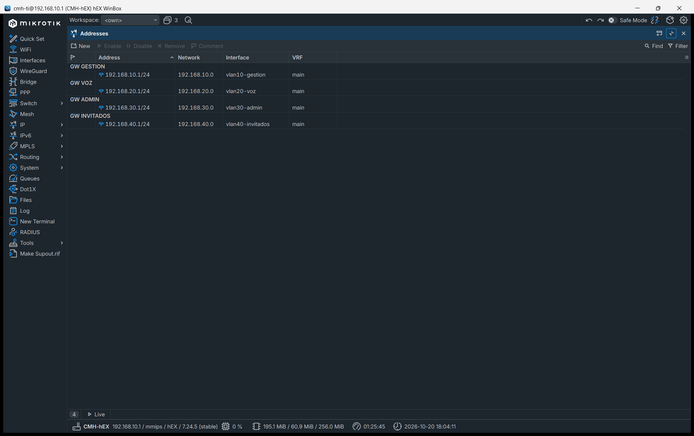

> **Qué se hizo.** El router es la puerta de enlace `.1` de cada red. 172.16.10.0/24 Gestión, 172.16.20.0/24 Voz, 172.16.30.0/24 Administrativa y 172.16.40.0/24 Invitados.

**Figura 34. Servidores DHCP.** Ruta: *IP → DHCP Server → DHCP*

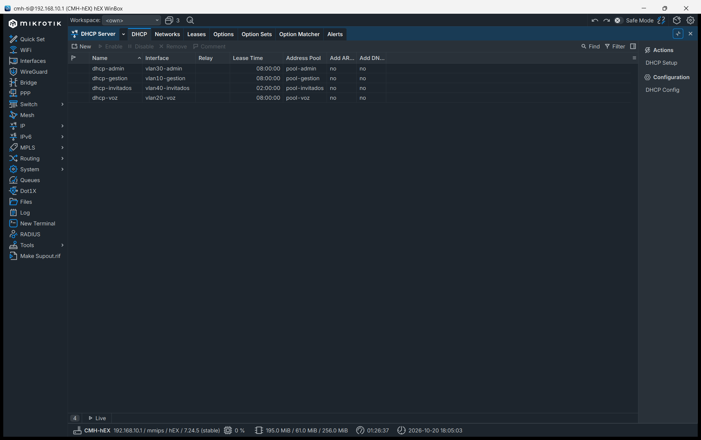

> **Qué se hizo.** Cada VLAN tiene su propio servidor DHCP y su rango (.100 a .199). En Invitados la concesión dura 2 horas y en las demás 8 horas.

**Figura 35. Asignaciones DHCP.** Ruta: *IP → DHCP Server → Leases*

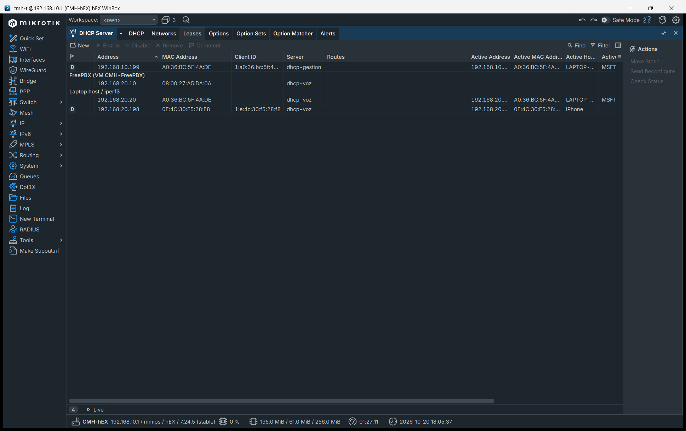

> **Qué se hizo.** Se reservó la **172.16.20.10** para la PBX (por la MAC de la VM) y la 172.16.20.20 para la laptop host. La laptop de TI recibió una IP de Gestión y un iPhone conectado al Wi-Fi `CMH-Voz` recibió una IP de la VLAN de Voz.

**Figura 36. Reglas del firewall.** Ruta: *IP → Firewall → Filter Rules*

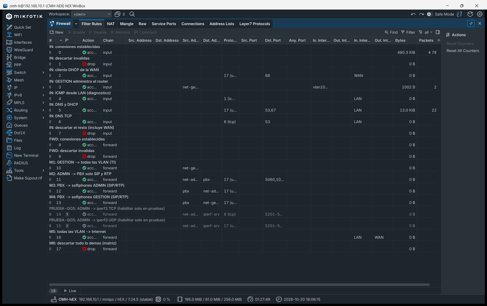

> **Qué se hizo.** Las reglas *input* protegen al router. Solo Gestión lo administra, el resto de redes solo usa DNS, DHCP y ping, y todo lo que llega de internet se descarta. Las reglas *forward* son la matriz entre VLAN. Gestión llega a todas (M1), Administrativa solo habla con la PBX por SIP y RTP (M2 y M3), todas salen a internet (M5) y lo demás se descarta y queda en el log (M6). Las dos reglas de iperf3 están desactivadas y se activan solo en las pruebas de QoS.

**Figura 37. NAT.** Ruta: *IP → Firewall → NAT*

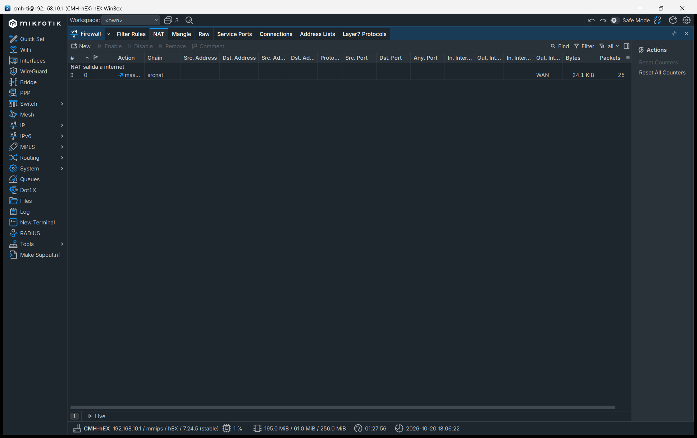

> **Qué se hizo.** Una regla *masquerade* traduce las direcciones de todas las VLAN al salir por la WAN (ether1).

**Figura 38. SIP ALG desactivado.** Ruta: *IP → Firewall → Service Ports*

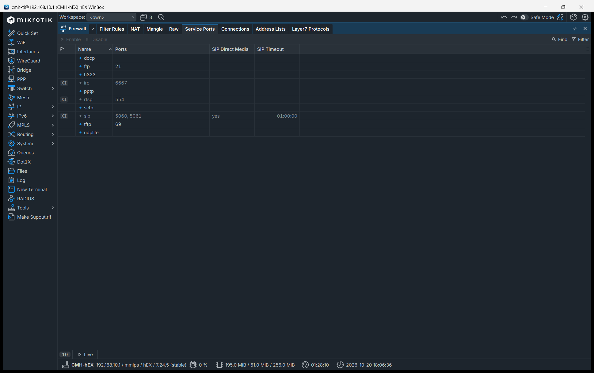

> **Qué se hizo.** Se desactivó el *helper* de SIP (bandera X en `sip`). La PBX ya maneja el NAT por sí misma, y el ALG del router suele romper el audio de las llamadas.

**Figura 39. Clasificación y marcado de la QoS.** Ruta: *IP → Firewall → Mangle*

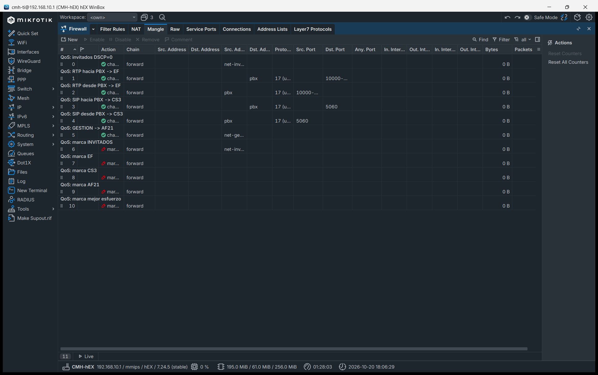

> **Qué se hizo.** Primero se borra cualquier prioridad que traiga la red de Invitados. Luego el audio (RTP) se marca **EF (46)**, la señalización SIP **CS3 (24)** y el tráfico de Gestión **AF21 (18)**. Con ese marcado cada paquete recibe una marca que decide en qué cola entra.

**Figura 40. Colas por prioridad.** Ruta: *Queues → Queue Tree*

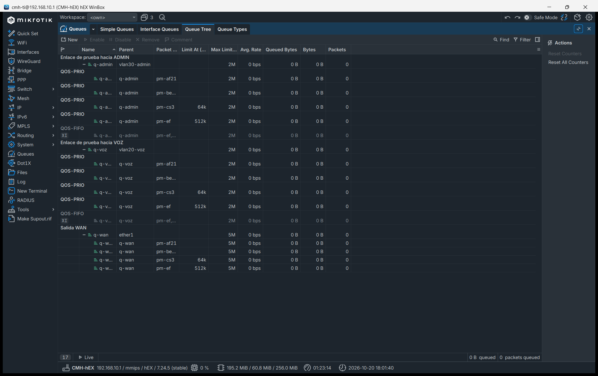

> **Qué se hizo.** Hay un árbol de colas hacia la VLAN de Voz, otro hacia Administrativa y otro hacia internet. En cada uno el audio va en la cola de prioridad 1 con 512 kbps garantizados, SIP en la 2, Gestión en la 5 y el resto en la 8. Las colas *QOS-FIFO* están desactivadas y sirven para la medición sin prioridad.

**Figura 41. Servicios del router.** Ruta: *IP → Services*

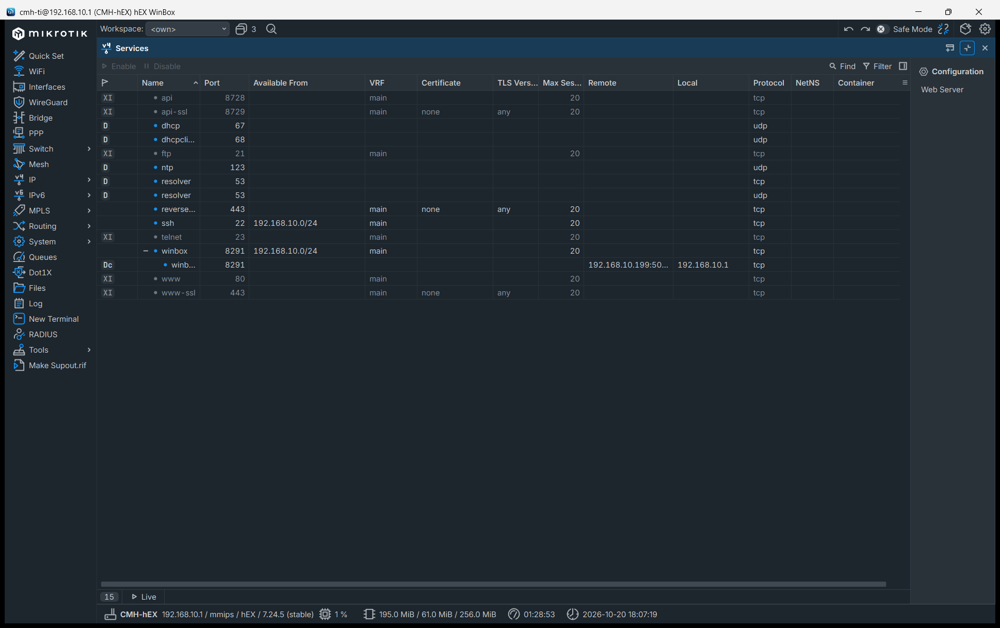

> **Qué se hizo.** Se apagaron telnet, ftp, www, www-ssl, api y api-ssl. Winbox y SSH solo aceptan conexiones desde la red de Gestión (172.16.10.0/24). También se limitó el acceso por MAC y el descubrimiento de vecinos a Gestión y se desactivó IPv6.

## 9. Punto de acceso Mercusys MW325R

Configurado el 20/10. Está conectado a ether2 del hEX, así que todo lo que entra por su Wi-Fi cae en la VLAN 20 de Voz.

**Figura 42. Red del punto de acceso.** Ruta: *Network → LAN* (en `http://172.16.20.2`)

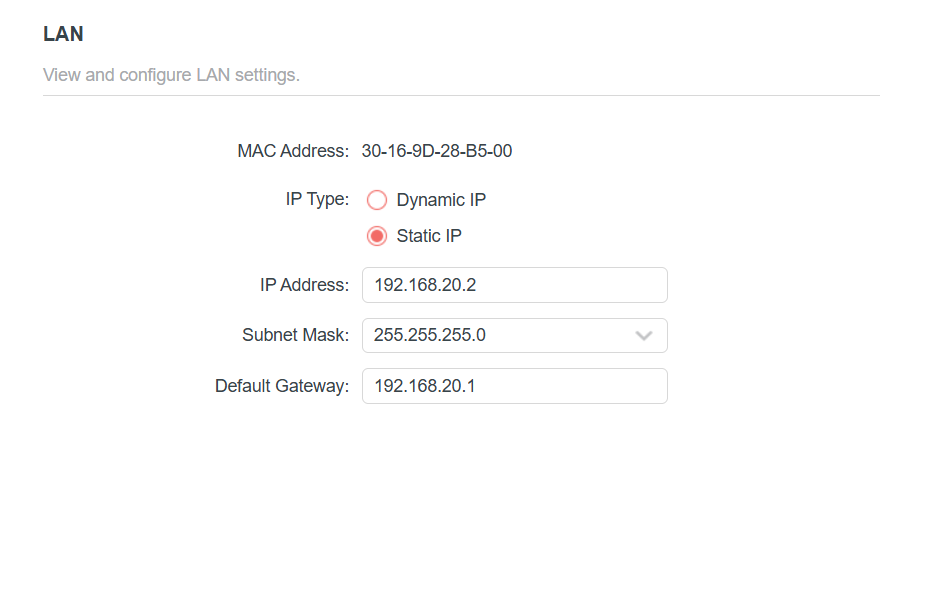

> **Qué se hizo.** El equipo se pasó a modo **punto de acceso**, con lo que apaga su propio DHCP y su NAT. Se le dio la IP fija **172.16.20.2** con puerta de enlace 172.16.20.1 (el hEX). Los celulares que se conectan a `CMH-Voz` reciben la IP del hEX, como se ve en la figura 35.

*Pendiente la captura del Wi-Fi (SSID `CMH-Voz`, WPA2-PSK con AES, canal fijo y WPS apagado), con la contraseña oculta.*

---

## 10. Cumplimiento del PDF

| Sección del PDF | Requisito | Cómo se cumple | Figuras |
|---|---|---|---|
| 5.3 | PBX operativa con versiones documentadas | FreePBX 17.0.33.2 y Asterisk 22.11.0 en Debian 12.15 | 1 |
| 5.3 | Al menos 5 extensiones con contraseñas robustas | 9 extensiones con secretos aleatorios de 32 caracteres | 2, 22 |
| 5.3 | Códecs justificados | ulaw, alaw, g722 y opus. G.711 usa unos 87 kbps por sentido con Ethernet | 4 |
| 5.3 | Registro de eventos | CDR con cada llamada y su grabación | 18, 27 |
| 5.3 | Administración solo desde la red de gestión | Web y SSH solo para redes Trusted | 19, 20 |
| 5.4 | Llamada en espera y transferencias | \*70, \*71, ## y \*2 activos en todas las extensiones | 5 |
| 5.4 | Buzón en al menos 2 extensiones | 4 buzones con PIN propio y saludo personalizado | 7 |
| 5.4 | IVR en español con 3 o más opciones, operadora, inválida y sin respuesta | IVR-Principal con 4 opciones y 0, dos reintentos y paso a la operadora | 8, 9, 10 |
| 5.8 | Sin credenciales predeterminadas | Contraseñas nuevas en Linux y FreePBX, sin usuario `admin` | 22 |
| 5.8 | Firewall y protección contra intentos repetidos | Firewall por zonas, SIP cerrado a redes no confiables y fail2ban | 19, 20, 21 |
| 5.8 | Sistema actualizado | Módulos de FreePBX y paquetes de Debian sin actualizaciones pendientes (20/10) | — |
| 5.8 | Respaldos | Respaldo diario y VM exportada | 23 |
| 6.1 | E1, acceso desde una red pública | Tailscale y llamada desde datos móviles | 25, 26, 27 |
| 6.3 | E3, troncal SIP | Troncal sip2sip registrada, entrante al horario e IVR y saliente con 9100 | Sección 7 |
| 6.4 | E4, funciones avanzadas (mínimo 2) | Grupo y cola, horario, música propia, grabación y buzón por correo (5 de 5) | 12 a 17 |

---

## 11. Registro de avance

| Fecha | Avance |
|---|---|
| 16/10 | VM base con Debian 12.15 y FreePBX 17 lista |
| 17/10 | Acceso seguro a la VM y contraseñas nuevas. Asistente inicial, ajustes SIP, 9 extensiones con buzones, firewall y fail2ban. Idioma español latino, audios, IVR y número 7000. Respaldo diario |
| 17/10 | Primeros teléfonos registrados (MicroSIP y Linphone) y primera llamada real al IVR |
| 17/10 | E4: grupo 8000, cola 8010, horarios, grabación y música propia. Saludos de los 4 buzones |
| 19/10 | VM completa exportada en `.ova`. E1 con Tailscale y llamada desde datos móviles |
| 19/10 | Asignación de extensiones por integrante y guion de pruebas (`GUIA-CELULARES.md`) |
| 20/10 | Primera sesión con el equipo: 7 teléfonos registrados por Tailscale. Vigilante de red en la VM (renueva la IP al cambiar de red sin reiniciar) |
| 20/10 | Módulos y sistema al día. E4 completo con buzón por correo (Gmail). E3 completo con troncal sip2sip, llamada entrante al IVR y saliente con 9100 |
| 20/10 | Scripts del router y procedimiento del AP adaptados al hEX RB750Gr3 y al MW325R (`plan/02`) |
| 20/10 | hEX reseteado y actualizado a RouterOS 7.24.5. Scripts de VLAN, firewall y QoS cargados. AP en modo AP con `CMH-Voz`. Respaldo del router |
| 23/10 | Sesión de pruebas con todo el equipo por Tailscale. Pruebas 1 a 17 y 19 completas. Capturas en la sección 12 |

---

## 12. Evidencia de la sesión de pruebas (23/10)

**Cómo se hizo.** El 23/10, de 18:17 a 19:35, el equipo siguió el guion de la sección 6 de `GUIA-CELULARES.md`. Cada integrante usó su extensión desde su propia red, conectado por Tailscale. Las capturas de esta sección salen de la PBX al terminar la sesión y no muestran contraseñas.

| Prueba | Qué se probó | Resultado | Evidencia |
|---|---|---|---|
| 1 | Las 9 extensiones registradas | Las 9 se registraron durante la sesión (MicroSIP en la laptop, Linphone en los celulares) | Figura 24 |
| 2 | Llamadas entre áreas | 1000 a 2001, 3001 a 4001 y 5001 a 1001, contestadas | Figura 43 |
| 3 y 4 | Llamada en espera desde laptop y celular | Música en espera y reanudación en los dos sentidos | Figura 43 |
| 5 | Segunda llamada entrante | A las 18:45 la 1000 atendió a la 3001 sin perder a la 2001 y alternó entre las dos | Figura 43 |
| 6 a 9 | Transferencias ciega y atendida, entre laptop y celulares | Las cuatro completadas (T1 18:37, T2 18:41, T3 18:48, T4 18:50) | Figuras 43 y 44 |
| 10 y 11 | Buzón cuando no contestan y cuando está ocupado | Saludo de "no disponible" y saludo de "ocupado" de Recepción, distintos | Figuras 44, 45 y 48 |
| 12 | Escuchar mensajes con \*97 | Leonardo escuchó el mensaje de Omar e Isaac los de Anthony | Figura 48 |
| 13 | Recorrido del IVR (7000) | Opciones 1, 2, 3, 4 y 0 llegaron a su destino. La opción inválida y la falta de respuesta pasaron a la operadora | Figura 45 |
| 14 | Grupo de timbrado 8000 | Sonaron 1000 y 1001 a la vez, contestó José | Figura 45 |
| 15 | Cola 8010 con tres llamadas | La cola repartió las llamadas entre la 2001 y la 2002 | Figuras 46 y 47 |
| 16 | Fuera de horario | El 7000 contestó con el menú de fuera de horario y la opción 3 llegó a Enfermería | Figura 46 |
| 17 | Llamadas entre celulares | Las cuatro contestadas con audio en los dos sentidos | Figura 46 |
| 18 | Acceso desde datos móviles (E1) | Probado el 19/10 | Figura 27 |
| 19 | Historial de llamadas | Registro completo en el CDR | Figuras 43 a 46 |
| 20 | Intentos de contraseña (fail2ban) | Ocurrió el 20/10, cuando un celular se configuró con la contraseña de otra extensión | Figura 49 |

**Figura 43. Llamadas de 18:15 a 18:40.** Ruta: *Reports → CDR Reports*

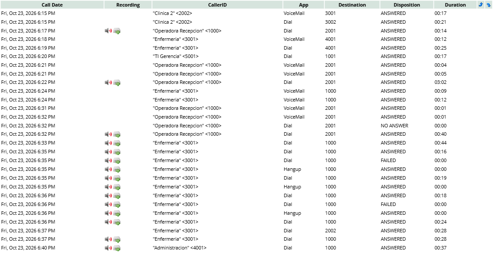

> **Qué se ve.** Cada fila es una llamada, con la hora, quién llamó (*CallerID*), a dónde (*Destination*), cómo terminó (*Disposition*) y cuánto duró. Aquí están las pruebas 1 a 7. Las llamadas entre áreas, la llamada en espera, la segunda llamada entrante y las primeras dos transferencias. Una transferencia aparece como dos filas, la llamada original y el tramo hacia la extensión que recibió la transferencia.

**Figura 44. Llamadas de 18:41 a 18:59.** Ruta: *Reports → CDR Reports*

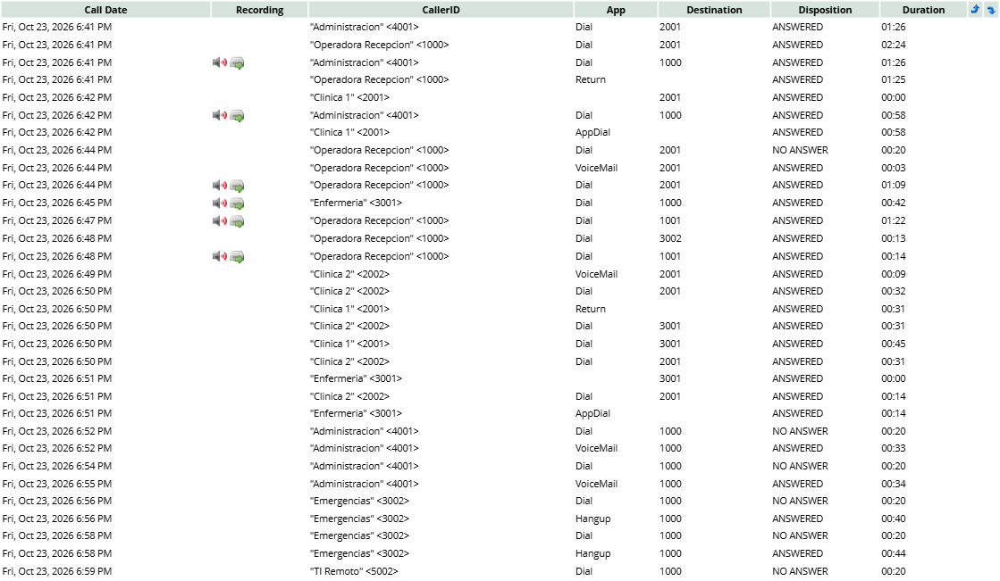

> **Qué se ve.** Las transferencias entre celulares (pruebas 8 y 9) y las llamadas a la 1000 sin contestar. En esas la columna *App* dice **VoiceMail**, o sea que la llamada terminó en el buzón y quien llamó dejó un mensaje (prueba 10).

**Figura 45. Llamadas de 19:00 a 19:27.** Ruta: *Reports → CDR Reports*

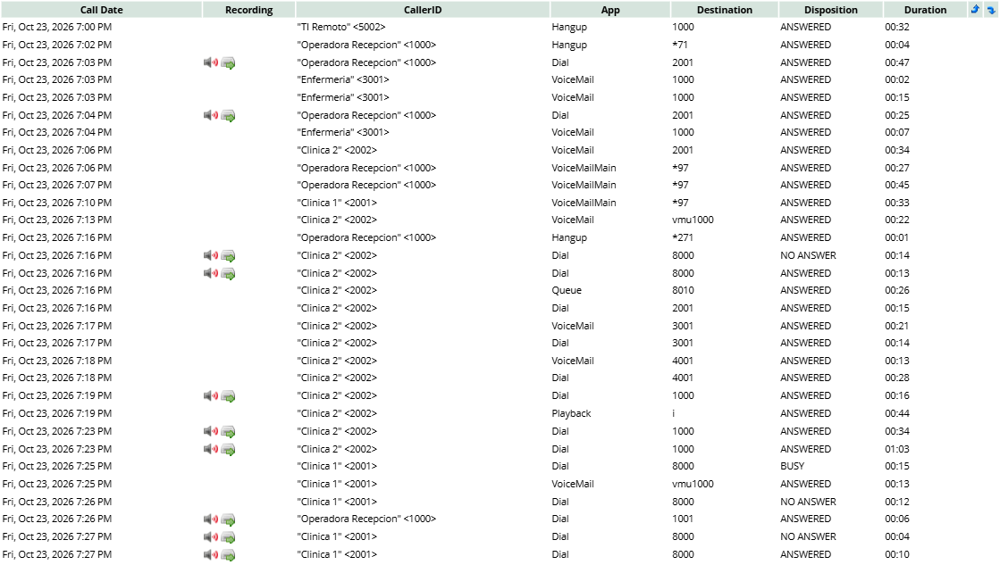

> **Qué se ve.** Las llamadas a la 1000 mientras estaba ocupada (prueba 11), las consultas al buzón con **\*97** (prueba 12), las siete llamadas al **7000** para recorrer el IVR (prueba 13) y las llamadas al grupo **8000** (prueba 14).

**Figura 46. Llamadas de 19:28 a 19:35.** Ruta: *Reports → CDR Reports*

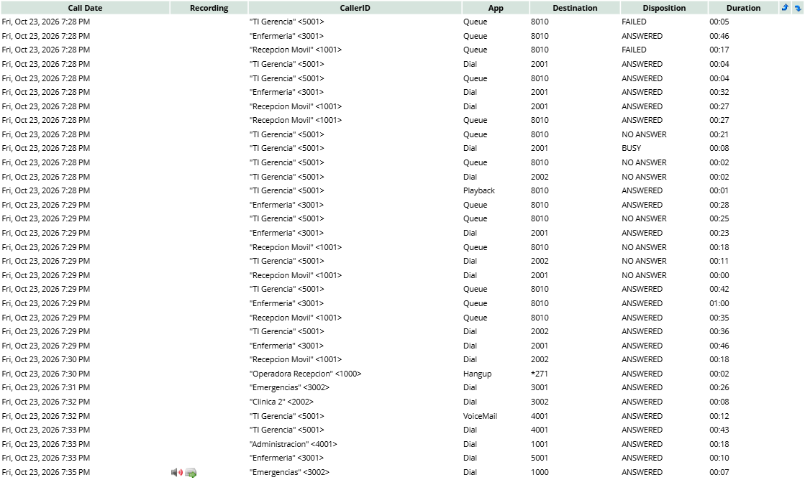

> **Qué se ve.** Las tres llamadas simultáneas a la cola **8010** (prueba 15), la llamada al 7000 en modo fuera de horario (prueba 16) y las cuatro llamadas entre celulares (prueba 17).

**Figura 47. Estadísticas de la cola 8010.** Ruta: *Reports → Asterisk Info → Queues*

> **Qué se ve.** La cola registra **6 llamadas atendidas** (C:6) con estrategia *rrmemory*, que reparte por turnos. La 2001 (Clínica 1) tomó 5 y la 2002 (Clínica 2) tomó 1. Las 3 abandonadas (A:3) son las veces que alguien colgó mientras esperaba, al repetir la prueba. Los dos agentes aparecen *Unavailable* porque la captura se tomó cuando los celulares ya estaban desconectados.

**Figura 48. Buzones de voz.** Ruta: *Reports → Asterisk Info → Voicemail*

> **Qué se ve.** Los 4 buzones configurados y sus mensajes nuevos. La **1000** (Recepción) tiene los mensajes que se dejaron en la prueba 10. La **2001** tiene 0 nuevos porque Leonardo ya escuchó el de Omar con \*97 (prueba 12), y al escucharlo el mensaje pasa a la carpeta de leídos.

**Figura 49. Intentos de registro fallidos.** Ruta: *Reports → System Logfiles → fail2ban*

> **Qué se ve.** Es el archivo que vigila fail2ban. El 20/10, a las 12:34 y 12:47, un celular intentó registrarse como la **1001** con una contraseña equivocada. Cada intento queda como *Failed to authenticate* con la IP de origen. Al pasar de 5 intentos en 10 minutos, fail2ban bloqueó ese equipo durante 30 minutos. Es la misma protección que pide la prueba 20.
